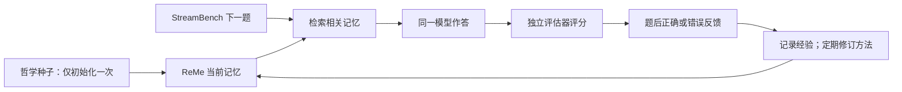

**建议采用“ReMe 记忆框架 + StreamBench 持续学习评测框架”，在上面增加哲学种子初始化与统一修订能力。** 这条路线能保留你最重要的设想：辩证唯物主义和批判理性主义只决定起点，之后允许被经验改写、融合或淘汰。

按团队合计 **20 人时**，第一版应交付一个可接入的 Python memory tool、两套种子、可复现对照实验和记忆变化回放。

**框架选择可以明确下来。**

| 层次               | 采用方案                                   | 直接复用的部分                               |
| ------------------ | ------------------------------------------ | -------------------------------------------- |
| LLA 的长期记忆     | **ReMe**，以已核实的 `v0.2.0.6` 为开发基线 | 程序性记忆结构、语义检索、本地存储、导入导出 |
| 持续学习运行与评测 | **StreamBench** 官方仓库                   | `Agent` 接口、逐题运行、反馈、评分与日志     |
| 我们的贡献         | **哲学初始记忆扩展**                       | 两套初始化、共享修订操作、演化记录与对照配置 |

ReMe 是已有开源程序性记忆框架；StreamBench 则提供“接收任务—作答—获得反馈—更新—下一题”的完整实验流程。两者组合构成本项目的 LLA 系统，第一版无需再接入 AgentScope 或 LangGraph。[ReMe](https://github.com/agentscope-ai/ReMe/tree/v0.2.0.6)、[StreamBench](https://github.com/stream-bench/stream-bench)

需要明确一个边界：**这不是把两个框架原样连接就完成了。** 已核实的 ReMe 默认总结流程主要抽取、去重和追加记忆，并不会自动改写种子内容；它已有的底层写入操作支持删除和插入，我们需要补上“决定修改什么”的小型操作。[默认流程](https://github.com/agentscope-ai/ReMe/blob/v0.2.0.6/reme_ai/config/default.yaml)、[写入执行器](https://github.com/agentscope-ai/ReMe/blob/v0.2.0.6/reme_ai/vector_store/update_vector_store_op.py)

**技术闭环建议这样实现。**

````

````

在 ReMe 中区分两类记忆：

- **经历记忆**：遇到什么题、给出什么答案、收到什么反馈。
- **方法记忆**：在什么条件下，如何理解问题、组织信息和形成判断。哲学种子属于这一类。

这种区分是为了检验“记住了一道题”和“改变了解题方法”，不需要另造两套存储系统。可以复用 ReMe 的 `TaskMemory`，在元数据中标记类别、来源、版本和关联事件。[现有数据结构](https://github.com/agentscope-ai/ReMe/blob/v0.2.0.6/reme_ai/schema/memory.py)

我们只增加三个薄接口：

```
initialize_memory(workspace_id, seed_pack)
evolve_memory(workspace_id, completed_events)
export_trace(workspace_id)
```

检索继续调用 ReMe 的 `retrieve_task_memory`。StreamBench 适配类在 `__call__()` 中检索并作答，在 `update()` 中接收反馈、记录经历和触发演化；这些扩展点已在官方接口中确认。[Agent 接口](https://github.com/stream-bench/stream-bench/blob/cf72f26f033cfa35ad209f087df8d8b1a1b4cbae/stream_bench/agents/base.py)

演化机制固定为：

1. 每题记录经历，每完成 **4 题**调用一次共享更新器。
2. 更新器读取这批已发生的任务、反馈和当前方法，提出最多 **2 项** `add / revise / retire`；也可以不修改。
3. 修改可以改变适用条件和操作建议；淘汰后，该条退出检索。
4. 保留旧版本供回放，但它不能继续进入模型上下文。
5. 更新器的模型、提示、预算对所有组一致，不加入某一哲学专属规则。
6. 初始化幂等，恢复运行不会重新灌入已淘汰的种子；无效修改不落库，写入失败恢复原状态。

这也意味着，**不能为了展示效果而要求系统必须修改几条哲学规则**。自然运行没有发生修订，同样应报告。

**两套哲学各做四张方法卡，先保持可比较。**

| 初始框架         | 四张卡的工程译解                                             |
| ---------------- | ------------------------------------------------------------ |
| 辩证唯物主义启发 | 在具体物质条件与关系中分析；区分历史阶段和适用条件；分析材料中实际存在的相互制约及主要关系；依据实践结果修订认识 |
| 批判理性主义启发 | 将解释视为暂定猜想；比较竞争解释；检查可能推翻判断的证据；避免为保护旧解释随意增补条件，允许修订或放弃 |

每张卡都写清“适用情境、建议操作、边界和来源”。两包采用相同格式、近似长度，运行内容用英文匹配基准，展示说明用中文。学派名称放在来源信息中，不要求模型扮演哲学家。

这是对哲学方法的选取和工程译解。辩证方法不应变成“所有问题都必须找到两个对立面”，证伪方法也不应变成“一道题答错就推翻整个世界观”。可追溯来源包括《实践论》《矛盾论》和 Popper 关于猜想、反驳与检验的论述。[《实践论》](https://www.marxists.org/reference/archive/mao/selected-works/volume-1/mswv1_16.htm)、[《矛盾论》](https://www.marxists.org/reference/archive/mao/selected-works/volume-1/mswv1_17.htm)、[Popper 原文节选](https://tildesites.bowdoin.edu/~j.knockel/falsification/)

**评测采用一个正式框架，覆盖三个非代码领域，并标清哪些属于扩展。**

| 领域                   | 数据与运行方式                               | 报告口径           |
| ---------------------- | -------------------------------------------- | ------------------ |
| 一般世界知识与多跳理解 | StreamBench 原生 **HotpotQA distractor**     | 官方任务的子集评测 |
| 经济学知识与推理       | **MMLU-Pro economics**，接入同一逐题反馈流程 | 经济学流式扩展     |
| 社会学知识与推理       | **MMLU sociology**，使用同一适配器           | 社会学流式扩展     |

经济学和社会学数据本身是静态题库，不能称为官方 LLA 基准；我们复用的是 StreamBench 的持续学习协议和评测框架。MMLU-Pro 确实包含 economics，MMLU 也有 sociology 科目。[MMLU-Pro](https://github.com/TIGER-AI-Lab/MMLU-Pro)、[MMLU 科目定义](https://github.com/hendrycks/test/blob/master/categories.py)

Evo-Memory 可作为相关工作，因为它已经研究经济学等领域的连续经验利用；目前尚未核实作者官方执行仓库，不把它列为必须依赖的运行框架。[Evo-Memory](https://arxiv.org/abs/2511.20857)

这里还有一个已查到的实现陷阱：StreamBench 的反馈对象带有 `ground_truth`，主循环还会合入原始数据行。我们的适配器必须只把**题目、自己的答案、正确或错误反馈**交给更新器，排除标准答案、标准解析和隐藏证据标签。[反馈与运行源码](https://github.com/stream-bench/stream-bench/blob/cf72f26f033cfa35ad209f087df8d8b1a1b4cbae/stream_bench/pipelines/run_bench.py)

**实验保留六组，避免把更多提示内容或普通经验积累误认为哲学收益。**

| 组别    | 初始方法记忆         | 后续方法更新 |
| ------- | -------------------- | ------------ |
| E       | 无种子               | 开启         |
| G       | 普通工程方法卡       | 开启         |
| D       | 辩证唯物主义启发种子 | 开启         |
| C       | 批判理性主义启发种子 | 开启         |
| D-fixed | 与 D 相同            | 关闭         |
| C-fixed | 与 C 相同            | 关闭         |

冻结组冻结**全部方法记忆写入**，经历记忆仍照常积累，避免通过新增一条相反方法绕过冻结。经历记录使用固定格式，不让更新器把方法建议塞进去。

第一版建议：

- 每域 **32 道在线题 + 8 道留出题**，另取不重叠调试题。
- 六组、两种预先固定的顺序，共 **1,440 次正式作答**。
- 各领域、组别、顺序使用独立记忆空间；同一条流内部严格顺序运行。
- 在线题先评分后更新，只计第一次答案。
- 留出题仅使用最终方法记忆，关闭经历检索、反馈和更新，检查方法能否用于新题。
- 所有组固定模型、检索设置、上下文上限和生成预算；报告实际总 token、耗时及更新开销。

主指标是分域正确率、前段成绩、留出成绩和成本。方法修订记录用于解释机制，不能单凭“修改次数更多”判定更好。这个规模适合参赛预实验；它能检验方法记忆是否影响答题与适应，尚不足以排名两种哲学，或证明真实世界观已经形成。

**20 人时的实现边界也应锁定。**

建议安排为：框架与接口冒烟 **2h**；记忆初始化、修订和回放 **6h**；两套哲学卡及普通方法对照 **3h**；基准接入与实验 **5h**；结果分析、说明和演示材料 **4h**。首版展示使用日志生成的简洁回放页面，重点呈现“旧方法—反馈—修改—后续表现”。

首个验收点必须跑通：**导入种子 → 检索 → 修订 → 重启保持修改 → 删除后不复活 → StreamBench 下一题继续学习**。同时检查冻结组无法改方法、不同实验不串记忆、答案字段没有进入更新器。

目前完成的是源码与接口核实，尚未安装并验证这套组合。运行前还需确定具体推理模型和 embedding 服务，并锁定依赖版本；这属于首个两小时的接入验收。原 MemoryGuard 不作为新方案依赖。