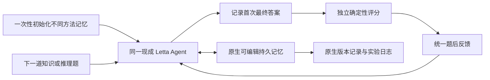

# PhiloAgent 计划 v0.0.2：哲学作为持续学习 Agent 的初始记忆

> 历史方案：已由 [v0.0.3](planv0.0.3.md) 替代。当前主选为 MemEvolve + EvolveLab；本阶段只交付最小项目框架。

日期：2026-10-29。状态：选型与实验讨论稿，已查官方文档和部分源码，尚未安装、运行模型或完成实验。原稿 `planv0.0.1.md` 保留。

## 1. 本轮确定的研究边界

使用一个现成的、具有持久记忆和原生记忆修改能力的 Agent，只改变其初始记忆内容：将特定哲学思想写入初始方法记忆。Agent 后续如何使用、修改、补充或放弃这些内容，沿用所选框架的原有能力。

本项目研究的是初始变量，不开发新的 Agent 框架、不设计新的记忆演化算法，也不为接入哲学另建更新器、奖励函数或强制修订流程。开发范围是种子数据、初始化配置、任务适配、结果记录和分析。

首轮沿用知识与推理任务。模型/API 和 GPU 预算暂不作为主要约束；原稿的“20 人时”不再作为硬边界。团队人数和截止时间尚未明确，因此本稿用验收阶段安排工作，不承诺具体完成日期。

可检验问题：**在同一个持续运行、能够修改记忆的 Agent 中，哲学启发的初始记忆，是否会改变后续任务表现和记忆演化轨迹？**

“形成真实世界观”“某种哲学本身更正确”不属于这组知识任务能够检验的结论。关于是否首次提出这一具体实验，需要单独完成针对性相关工作检索，现阶段不写成已证实的首创事实。

## 2. 推荐选型：MemGPT/Letta 路线，以现行 Letta Agent SDK + MemFS 落地

**主推荐为 Letta；先用其现成 Agent 和可编辑持久记忆，不再以 ACE 改造版或 ReMe 拼装系统作为首版方案。**

MemGPT 是这一技术路线的研究来源：让语言模型管理分层记忆并保持长期交互状态。Letta 是该路线后续发展的 Agent 系统。这里采用的是外部记忆驱动的持续适应，模型权重保持固定；不是梯度训练式的 continual learning。[MemGPT 论文](https://arxiv.org/abs/2310.08560)、[Letta 官方仓库](https://github.com/letta-ai/letta)

当前官方 Agent SDK 支持创建时传入 `memory`，每个 `{label, value}` 成为初始记忆文件；MemFS 提供持久、可编辑的记忆，并使用 Git 记录。Agent 可以在后续工作中修改记忆，框架也有原生 dreaming 能力。因此“换初始记忆，其余机制保持一致”有现成入口。[初始记忆与 MemFS](https://docs.letta.com/agent-sdk/memory)、[创建 Agent](https://docs.letta.com/agent-sdk/agents)

### 选型比较

| 候选 | 与本题的关系 | 本轮决定 |
| --- | --- | --- |
| **Letta / MemGPT 路线** | 现成有状态 Agent；可设置初始记忆，后续由 Agent 原生读写；适合把初始化作为实验变量 | **主选**，以现行 Agent SDK + MemFS 做接入验收 |
| **Hermes Agent** | 现成 Agent，内置跨会话记忆及 `memory` 修改工具；适合 Python 接入 | 备选，若 Letta 的运行环境或模型接入不合适再切换 |
| ReMe | 记忆组件与自动维护流程，单独不等于完整任务 Agent | 不作为首轮必需依赖；保留核查资料 |
| ACE | 有 playbook 初始化和在线适应；但已核实的默认 Curator 执行器主要支持 ADD，修订/淘汰需要扩展 | 不符合本轮“直接复用原生修改机制”的优先要求 |
| StreamBench | 任务流、评分与反馈协议 | 保留为评测来源，不称为 Agent 主框架 |

Hermes 原生工具的具体动作应按锁定版本核实：本次看到的当前源码为 `add / patch / remove`，旧文档常写 `replace`；其记忆在会话开始时装入，不能默认本轮写盘会立即改变当前提示快照。[Hermes 原生记忆工具](https://github.com/NousResearch/hermes-agent/blob/main/tools/memory_tool.py)

### Letta 版本边界

当前活跃源码位于 `letta-ai/letta-code`，原 `letta-ai/letta` 的 V1 server 已归入历史分支。V1 SDK 文档仍在，不能据此说全部旧云 API 已停服；但新项目应优先采用官方推荐的现行 SDK。现行 Agent SDK 为 TypeScript，不能直接把旧 Python `memory_blocks` 示例混入新接口。[官方迁移说明](https://docs.letta.com/v1-sdk)、[现行源码](https://github.com/letta-ai/letta-code)

本轮确认的是功能与接口适配性，尚未完成实际安装验证。候选锁定版本为 **Letta Code v0.34.26 + Agent SDK v0.8.55**；备选为 **Hermes v0.22.5**。首个接入阶段仍需验证这组版本的实际配合，并锁定传递依赖、模型及配置。避免使用浮动 `latest` 作为正式实验记录。[Letta Code release](https://github.com/letta-ai/letta-code/releases/tag/v0.34.26)、[Agent SDK release](https://github.com/letta-ai/letta-agent-sdk/releases/tag/v0.8.55)、[Hermes release](https://github.com/NousResearch/hermes-agent/releases/tag/v0.22.5)

当前 Letta SDK 的 `memory` 初始化入口在类型注释中已标为迁移中的旧字段，但该候选版本的实现仍接受它，官方指南也仍使用该入口。接入时要做创建后读回，不能把文档示例当作本机运行证明。不同 backend 对高级配置的支持也不同，首个验收先用默认 Agent 和最少初始化参数，避免依赖未经验证的权限或 dreaming 创建选项。具体证据见 [原生 Agent 选型核查](research/native-agent-selection.md)。

## 3. 哲学具体放在哪里

在创建 Agent 时初始化同名、可修改的方法记忆，例如 `working-principles`。所有组具有相同身份说明、相同工具、相同记忆容量和相同记忆使用说明，只让这部分初始内容不同。

建议用同一段说明描述它：

> 这里保存当前可修订的工作方法。可以根据任务经验保留、补充、修改或移除其中的内容；它们不要求被无条件遵守。

这段说明对空初始化组和所有种子组都一致。哲学只初始化一次；恢复运行或开始下一题时，不重新灌入原始种子。不把“必须坚持某哲学”写进固定人格或不可修改的指令。

注意：Letta 的核心记忆会编译进模型的 system 上下文，但记忆文件本身可以改变。官方 SDK 文档仍以 `system/` 布局说明，候选 runtime 也支持根目录布局；实际位置通过原生 `getDeviceStatus()` 和创建后读回确认，不硬编码旧路径。关键区别是“当前可修改的记忆内容”与“每轮重新写入的不可变哲学指令”，不能仅按消息角色判断是不是记忆。

首版保留两套哲学，各用四条短方法，格式相同、长度接近。来源说明放在实验材料中，不要求模型扮演某位哲学家。

| 初始内容 | 拟采用的方法方向 |
| --- | --- |
| 辩证唯物主义启发 | 从具体条件和关系分析；识别条件或阶段的变化；分析实际存在的相互制约及主要关系；根据实践反馈修订认识 |
| 批判理性主义启发 | 将解释作为暂定猜想；比较竞争解释；主动检查可能反驳当前判断的材料；避免为保护旧结论任意添加解释 |
| 普通工程方法对照 | 明确任务与输出要求；分解问题；核对材料和约束；检查最终答案与已知错误 |

这些是工程译解，不是对完整哲学体系的替代。辩证方法不强迫每题找“两种对立面”，批判理性主义也不等于一次答错就否定整个方法。具体种子文本在开发集试运行后锁定，不能根据正式测试成绩反复润色。[《实践论》](https://www.marxists.org/reference/archive/mao/selected-works/volume-1/mswv1_16.htm)、[《矛盾论》](https://www.marxists.org/reference/archive/mao/selected-works/volume-1/mswv1_17.htm)、[Popper 原文节选](https://tildesites.bowdoin.edu/~j.knockel/falsification/)

**不另外规定每 4 题修改一次、每次必须修改两条、什么哲学内容不得被删。** 原生机制可能改写、保留或不使用种子，这些都是观察结果。

## 4. 最小系统与接入工作

需要做的接入只有四类：

1. **初始化配置**：为每组、每条题流创建独立 Agent，写入对应初始记忆；保留同一基座配置。
2. **任务适配**：从数据集取公开题面，将它发给现成 Agent，读取第一次最终答案，再发送统一反馈。
3. **结果记录**：保存任务 ID、顺序、答案、评分、记忆变化、原生工具调用、模型配置及实际用量。
4. **实验分析**：比较学习曲线、独立新题表现和种子的保留/变化情况。

任务适配器只负责发送题目和反馈，不生成记忆内容，不替 Agent 判定如何修订，不重写原生思考或学习循环。

原生后台维护采用一个统一、明确的配置。先验证前台原生读写能闭环；如果启用 dreaming，所有组使用相同触发方式，并确认后台更新完成再开始下一道计分题。不能为某个哲学组额外安排更多反思机会。若无法可靠等待后台任务，则首轮通过原生配置关闭异步 dreaming，保留前台原生记忆工具，报告这一条件。

## 5. 首轮实验只设四组

| 组 | 附加初始方法记忆 | 后续机制 |
| --- | --- | --- |
| E | 无额外方法种子；共同的原生默认记忆仍保留 | 原生可编辑记忆 |
| G | 普通工程方法 | 相同 |
| D | 辩证唯物主义启发方法 | 相同 |
| C | 批判理性主义启发方法 | 相同 |

最重要的比较是 **D/C 与 G**：排除收益仅来自“多给了一些有用的方法说明”。D/C 与 E 用于比较相对原始初始化的效果。E 不是无记忆 Agent，它同样可以积累和修改记忆。

G、D、C 的初始方法数量、文本结构和 token 长度尽量匹配；记录实际数值。各组使用相同模型、工具权限、记忆容量、运行参数、题序与反馈规则和字段；具体正确/错误值由各自答案决定。不同组的记忆仓库不能共享写入。

固定种子、完全无记忆、第二种 Agent 框架是后续消融，**不作为首轮开始的前提**。若固定组只能通过提示“不要修改”实现，不把它称为严格冻结；如果原生权限只能禁止全部记忆写入，也应按实际能力命名，不声称只冻结了哲学内容。

## 6. 任务与评测方式

第一步只用 HotpotQA distractor 打通；其给定材料适合观察信息整合与判断方法。跑通后再扩到 MMLU-Pro economics、MMLU sociology，延续原稿三个领域的意图。

| 任务 | 主要评分 | 报告名称 |
| --- | --- | --- |
| HotpotQA distractor | 标准化 Exact Match；如用 F1，锁定 HotpotQA 官方实现 | 基于 StreamBench 协议的 HotpotQA 子集实验 |
| MMLU-Pro economics | 首次答案的选项正确率 | 经济学题库的流式扩展 |
| MMLU sociology | 首次答案的选项正确率 | 社会学题库的流式扩展 |

采用 StreamBench 的先回答、后反馈协议；若仅复用数据和评分、不运行其完整 runner，就如实这样描述。两个 MMLU 子集不是官方 StreamBench 原生任务，也不是天然带时间关系的环境。[StreamBench 论文](https://arxiv.org/html/2406.08747v2)、[MMLU-Pro](https://huggingface.co/datasets/TIGER-Lab/MMLU-Pro)、[MMLU](https://huggingface.co/datasets/cais/mmlu)

每道题流程：

1. 仅提供题目和允许的材料；选项顺序固定并记录。
2. 让 Agent 使用相同的原生能力完成作答，记录其首次最终答案。
3. 在 Agent 之外评分。主实验只给“正确/错误”的题后反馈。
4. Agent 可以依据反馈使用原生记忆工具，无须重新回答已计分题；若产生后续答案，不覆盖第一次成绩。
5. 记录本题结束时的持久记忆状态，再继续下一题。

题后提供标准答案也是一种可研究的监督协议，但应另设条件，不能与 correctness-only 混合。标准答案、标准解析、隐藏 supporting facts 和未来题目不能进入当前作答上下文。尤其不能直接把数据集整行对象传给 Agent；MMLU-Pro 的 `cot_content`、`answer_index` 等字段只留给评测端。含答案的数据和评测端文件也不能暴露给 Agent 的文件或 shell 工具；用原生工具权限或隔离运行目录/挂载范围验证这一点，仅在提示中隐去字段还不够。

会话处理优先使用框架原生的新 conversation/session 能力：每题新短期会话、同一持久 Agent。先验收短期历史确实没有直接带入、持久记忆仍然保留；不能把网络断开重连当作清空上下文。若原生能力不便实现，首轮所有组统一连续会话，并将结果解释为整体持续 Agent 效果，后续再区分短期历史与持久记忆贡献。

先用不参与正式评测的少量题做接入验收，再做四组小规模预实验。正式实验可以从每域 96 道在线题、96 道留出题、5 个预先固定题序规划，但这只是起点，需根据预实验波动和去重结果调整。已核实 sociology 当前 test=201、validation=22、dev=5，调试题可来自 validation/dev；其 192 道 test 拆分仍要在冻结 manifest 时复核。8 道留出题仅适合冒烟，不能支撑稳定效果判断。

多种顺序使用同一题集时，不视为多份独立新题。报告每域、每顺序差异和不确定性，不只报告最好的一次；费用和调用数从原生 trace 汇总，不能再按自定义“每 4 题更新一次”估算。

## 7. 观察什么才算有价值

- **任务结果**：相同题流中，相对 G/E 的首次答案正确率差异与随时间的变化。后半段题可能更容易，因此不能只比较前后段就断言学习。
- **记忆行为**：初始方法是否进入实际上下文；哪些被保留、改写、移除或与新经验结合。引用实际记忆 diff 和工具调用，不依据 Agent 自述认定已经写入。
- **新题效果**：如果框架原生支持独立克隆/读取同一记忆快照，比较初始与最终记忆在同一未参与学习的留出集上的表现。每题隔离测试产生的写入，或使用真正只读配置。做不到隔离时，不把依次答题的结果称为冻结记忆测试。

自然运行没有修改、哲学组与普通方法相当、某些领域下降，均应记录。支持修改是框架能力；实际是否修改、修改后是否有用，是实验结果。

若第一轮发现稳定差异，再增加第二个基座模型、同一哲学的不同表述版本、跨领域迁移等验证。这样可以检查结果是否只来自某一句提示措辞。

## 8. 可实现性验收与工作阶段

### 阶段 A：框架接入验收

以原生工具完成下列最小闭环，不为通过验收新增演化算法：

- 创建两个隔离 Agent，注入不同的同名初始记忆，读回一致。
- 在专用调试案例中明确要求 Agent 修改一条可修改记忆；确认是 Agent 调用了原生工具，而非测试脚本代写。
- 移除其中一条内容，确认后续会话不被初始化逻辑重新加回。
- 重启或新建会话后，验证修改仍存在且对另一 Agent 无影响。
- 发送一道任务、记录首次答案、发送反馈、运行下一题，能追踪所使用的记忆状态。

明确要求修改仅用于测试工具功能；正式实验不要求必须修改。若 Letta 当前版本在模型接入、隔离或持久化上无法通过验收，优先试 Hermes 的原生能力，不通过开发新记忆系统来补齐。

### 阶段 B：种子与四组预实验

完成两套哲学种子和高质量普通方法对照；所有组使用同一段记忆用途说明。在 HotpotQA 小规模跑通并核实反馈边界、模型输出解析、记忆变化和实际调用开销。

### 阶段 C：锁定配置与正式对照

锁定框架/SDK版本、模型、原生记忆设置、种子文件、数据 ID、题序、反馈和评分脚本；运行四组正式对照。正式留出结果不用于修改种子。

### 阶段 D：参赛交付

交付种子包、初始化与任务运行脚本、可复现实验配置、结果与记忆轨迹分析、安装说明及第三方资源清单。演示围绕“不同起点—相同原生机制—真实后续结果”，不需要新做一个 Agent 平台。

## 9. 对原稿的具体调整

| 原稿内容 | 本稿处理 |
| --- | --- |
| ReMe 0.2.x + StreamBench 拼成 LLA | 改为优先使用现成 Letta Agent，StreamBench 留在评测层 |
| 自定义 `evolve_memory` 与 add/revise/retire 更新器 | 删除为实施要求，使用所选 Agent 原生记忆修改能力 |
| 每 4 题统一演化、每次最多 2 项修改 | 删除，原生学习配置在各组一致即可 |
| 六组、固定组、多个域同时起步 | 首轮四组 E/G/D/C，一个领域接入后再扩展 |
| 32 在线 + 8 留出作为主要实验 | 仅作预实验规模，正式规模根据波动和题量确定 |
| 20 人时交付 | 不再作为硬约束 |
| 两套哲学、可修改初始方法、过程回放 | 保留，为本项目核心 |

比赛要求可运行成果、可核验贡献和第三方资源披露，不要求另造底层框架。本项目可贡献可复用的哲学初始化资源、对照实验和持续学习行为证据；最终申报方向按实际开放成果选择。提交约束见 [比赛对齐笔记](research/competition-alignment.md)。

## 10. 核查资料与当前边界

- [原生 Agent 选型核查](research/native-agent-selection.md)：Letta/Hermes 原生接口与版本边界。
- [框架核查](research/framework-audit.md)：ReMe 新旧版本及其他框架职责。
- [评测核查](research/evaluation-audit.md)：StreamBench 源码问题及可选增强实验。
- [概念与相关工作核查](research/hypothesis-audit.md)：概念边界、ACE 源码事实与哲学操作化。

以上核查中早先的 ACE 改造路线及八组增强实验，不构成本稿实施要求；以本稿和用户最新确认的“只改变初始记忆，复用现成 Agent”边界为准。本次只完成资料研究和计划整理，未安装 Letta/Hermes、未运行正式模型、未证实哲学种子的效果。
