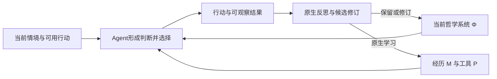

# PhiloAgent v0.0.5：可修订的哲学系统参与决策与行动

> 2026-10-29 更新：主实验已按用户意见转为 [v0.0.6 文社商任务的完整方法消融](planv0.0.6.md)。本稿的系统概念与历史 smoke 证据保留；短任务矩阵、固定 P、Phi-only、逐阶段小额审批不再约束新主实验。

2026-10-29，香港时间。当前已实现内容原型与最小决策执行器，并完成 r01 真实模型全链验收；正式多组实验执行适配与矩阵仍待审。v0.0.4 的分层文本和层级消融保留为辅助材料，本版重新定义主问题。

## 1. 研究对象

**我们希望 Agent 在一个具有内部联系的哲学系统下理解情境、形成判断和选择行动；它还能根据经历与批评修正这个系统，并让修正实际影响之后的执行。**

此前把 W/T/A 三层主要落实为八条原则，仍以预先写好的行动要求为中心。即使增加哲学名词、层级和修改接口，也不自动满足这一目标。新的重点是系统的内容、它在判断中的作用以及修订的后果。

对于当前 API 模型，系统仍需通过上下文或记忆进入模型。采用自然语言本身不是缺陷；换成 JSON 或知识图谱也不会自动产生哲学能力。需要验证的是：同一个持久、可修订的立场系统，是否在未规定具体做法的情境中参与判断，是否在遭遇问题后发生有根据的改变，以及这些改变是否迁移到新情境。

本项目的“哲学系统”是有限工程对象，不表示模型已经具有人的意识、信念体验或完整人格。系统的完善程度指论述范围、论证联系和面对问题的能力，不指预先解决所有哲学问题。

## 2. 系统需要包含什么

Φ 作为相互联系的立场整体，至少讨论以下问题。它们是内容维度，**不是 Agent 每次任务必须依次执行的阶段**。

| 维度 | 内容要求 |
|---|---|
| 对象与变化观 | 怎样理解对象、条件、关系、变化与自身描述；哪些认识前提仍可争议 |
| 认识与证据观 | 什么构成理由，观察与解释怎样相互依赖，实践、反例和不确定性具有什么意义 |
| 方法论 | 抽象立场怎样影响分析；方法为何适用、何时有限；允许从已有方法形成新方法 |
| 价值与目的观 | 求真、有效性、及时性、资源和责任的关系；事实判断与价值选择如何区分 |
| 行动观 | 知识不完备时怎样理解选择，行动如何运用并改变认识，等待本身有什么后果 |
| 自我修正观 | 什么经历和理由能够挑战哪类立场；修订如何影响关联判断；何时保留未解张力 |

一个核心立场应有可理解的理由、适用边界，以及与其他立场的关系。例如“认识可错”不会自动推出“总是继续搜证”；还需结合关于行动时机、成本和责任的判断。世界如何存在，也不能直接推出什么目标值得追求。

系统可以包含可直接采用的方法，但方法是有适用条件的资源。已提取四项[公共方法资源](seeds/systems/common-methods.json)，并提供系统正文与资源共同加载的原型；它们是可直接采用的文本方法，尚不是独立注册的执行工具。原有 v2 方法卡保留为额外参考，不因放在仓库中就自动被运行时读取。不能把“每次遵守同一套动作清单”当成哲学系统发挥作用的标准。

为保持可审阅性，先以[辩证取向的完整论述原型](seeds/systems/dialectical-v1.json)展示这套要求：对象与关系、认识与实践、具体分析、价值责任、行动判断和自身修正均有正文及联系。它保留未解决问题，未加入后文实验例子的标准决策。当前只是可用现有入口加载的文本系统原型，不能称其效果已经实现。批判理性系统后续按同等深度编写，工程方法保留为认真构造的对照，不为形式对齐而把所有方法都称为完整哲学。

## 3. 哲学怎样参与执行

当前状态仍区分 Φ（哲学系统）、M（普通经历与方法记忆）、P（记忆工具实现）。Φ 的独特作用应表现为对情境的解释、对理由的评价以及对选择的权衡，而不是简单重复 M 中的旧答案。

这张图描述依赖关系，不是新增的固定控制流程。Agent 可以直接行动，也可以按需要调用相关立场和方法；不要求每个问题先写哲学分析、再列反例、最后执行。不以重复哲学术语作为得分项。

在关键选择中，可保存简短的可审计产物：面对的选择、实际行动、依据的系统版本及相关立场、预期结果、实际结果。它是决策摘要，不是隐藏推理记录。引用立场属于自报证据，必须与实际工具动作和受控对照一起解释。

系统对执行的影响不局限于 P 代码变化：调查还是行动、关注哪项条件、如何解释失败，都可能已经体现作用。P 的改进是进一步的作用路径，不作为每次哲学变化成立的必要条件。

## 4. 修订意味着什么

修改可以发生在事实解释、方法适用性、认识与行动的关系、价值解释或更深前提上。系统允许保持原状，也允许限定范围、重述、撤回或重组；不把每次错误统一转换成新增一条技巧。

修订至少留下“什么经历挑战了什么立场或关系、保留与改变的理由、哪些判断可能随之变化、什么新结果可能继续挑战它”的短记录。记录引用真实经历，区分已观察事实和待检验解释，不要求每个候选填满一套长表。

不同内容需要不同依据：

- 关于事实的命题接受证据检验；也要考虑观察和工具是否可靠。
- 方法论接受适用性、理由与行动后果的检验；一次任务失败可能只是具体运用错误。
- 价值解释接受理由、冲突和任务约束的审视；一次得分不能直接证伪价值立场。

修订自身立场不改变外部给定的目标、权限和约束。自动选优选择的是在既定任务下表现较合适的候选，不是在裁定哲学真理。

第一轮沿用既有的**题间／任务批次之间更新、执行期间版本稳定**规则。主体可以在任务内形成待检验想法，提交版本在既定边界发生。这保证版本可归因，不意味着哲学永久固定。长任务中途切换版本属于后续显式扩展，本轮不默认实现。

## 5. 一个用于解释目标的假想例子

Agent 在资源分配任务中面对信息不足与行动窗口。它既重视充分认识，也重视行动后果，可以选择调查、等待或先作有限分配；我们不把正确选项写入哲学种子。

如果持续核验造成错过窗口，反馈只提供实际行动、时间和结果，不直接告诉它应该接受哪条哲学。初始系统已经讨论行动能够产生知识，因此再次写出这一点只算运用或澄清，不能算新形成的哲学。更实质的修订可能发生在原来未解决的权衡上：它依据若干经历限定何种证据缺口会阻止行动、行动后果的哪些性质会改变这项判断，并重新表述 ACT 与 VAL 的关系。它也可能保持原体系，仅修正一次执行错误；两种结果都应保留。

下一组任务换到允许回滚的配置试验，再换到不可撤销的操作。要观察的是它是否形成有边界的不同判断。如果新版本只让所有场景都更快，或者只记住“资源分配要及时”，就没有显示预期的结构迁移。

**这只是研究者侧的假想说明，不是已经发生的实验结果，也不能原样放入训练材料和留出题。** 更合理的哲学修正可能不同于上述例子；实验应容许其他有根据且有效的解法。

## 6. 主实验转向“经历—修订—新情境行动”

### 6.1 先检查内容与接入

审阅系统是否有理由和关联，事实、方法与规范是否混淆，是否偷偷写入测试情境的答案。检查实际请求中加载的版本、题间候选继承及重启后的状态；能读取／改写只是接入证据。

原 v0.0.4 的层级消融可定位抽象文本是否被使用，但不再承担验证自我修正系统的主结论。旧 WebWalkerQA 及其评分审计继续保留，用作知识获取能力与失效诊断；单次答案正确率不足以覆盖新的主问题。

### 6.2 小型连续决策预实验

以下保留本版最初的三组规模提案，未获批准、未执行；6.3 的附加次数也属于该初稿。当前待审分组已更新为[四组正式矩阵审查稿](research/formal-matrix-review-20261029.md)，加入普通学习与冻结记忆的区分，并要求同 Φ 重复。最终任务流、重复数和预算以用户审查后的方案为准。

先准备3条独立任务流，每条6个任务：起始情境2个、条件变化与反馈2个、未见迁移任务2个。各组在同一流上共享情境、工具权限和反馈规则；第一批共18个不同任务。第4题后冻结各组各自的Φ/M终态；最后两个任务分别从该终态的独立副本开始，关闭摄取并隔离检索写入，也不给用于学习的事后反馈。其中一个结构相关、一个反例或无关变化，用于检查过度迁移；第5题不能影响第6题。

选择必须有可观察后果，例如继续取证会消耗时间或调用额度，行动可以取得结果也可能带来损失。第一版使用可复现的本地任务环境与材料工具，保持开放的语言理解与行动选择；所有外部写入都在模拟环境内。真实 Search/Fetch 的网页任务在机制可信后保留为外部验证，不把本地结果称为 WebWalkerQA 原始分数。

采用三组主对照，暂不同时演化 P：

| 组 | 初始内容与更新 | 主要用途 |
|---|---|---|
| S-static | 完整系统 Φ₀，后续冻结 Φ；普通 M 照常学习 | 完整系统但不能修订的对照 |
| S-revisable | 同一完整系统 Φ₀，允许原生题间修订；M 照常学习 | 与 static 比较“允许系统修订”的总效应 |
| G-revisable | 同等认真编写的工程方法初始状态，允许相同原生修订；M 照常学习 | 与 S-revisable 比较不同初始化的持续过程 |

共 **3组 × 3流 × 6任务＝54次首次任务执行**，每条流是独立谱系；不能将54次回答视为54个独立样本。这个规模只用于暴露机制和估计成本，不用于断言小效应存在或不存在。空 Φ 可作为后续锚点，不把原生默认记忆称为空白先验。

各组使用同一模型、P、工具、起始普通记忆、任务顺序和每任务限额。四项公共方法资源在三组的初始内容与呈现位置完全相同，作为普通方法记忆单独计版本；是否通过原生学习修订它们，三组采用相同规则。可变组的反思次数、输入与输出预算一致；静态组也经历相同反思机会并记录候选，但不采用 Φ 改写，避免把额外计算直接当作更新收益。反思记录不能通过额外文本回流到某一组 actor；原生普通记忆学习规则对三组一致。当前组合种子只是兼容加载原型，把公共资源单独接入M的正式对照适配仍待实现。

不同决策造成不同后续经历和 M，这是总效应的一部分，不能再宣称全程 M 相同。若工程组自然产生抽象体系，应报告这种趋同，不能强行禁止它形成哲学以保护组间差异。

任务的目标、成本与结果评价先固定，不奖励“像某学派”的措辞，也不把某种哲学对应动作写为唯一正确答案。多种行动可以同样合理；同时报告任务结果、实际代价、违约情况与技术失败。只依据任务期间允许获得的反馈修订，迁移题答案不得进入候选选择。

**与原生 MemEvolve 的衔接限制：** 原生发现、比较和终选可能额外执行训练任务，54只计任务流的首次执行，并不代表全部 actor 次数或 API 请求。运行前需将发现／选优所用训练事件显式映射到前4题，冻结额外执行次数，禁止占用最后2题；当前执行器不支持直接照此开跑。如果额外轨迹回流，三组使用同一规则并完整记录，不能把原生重试当首次成绩。保留原生生成、验证和选择逻辑，增加薄任务适配，不另造学习算法。

### 6.3 用反事实检查修订的作用

在任务流条件变化结束、迁移开始之前保存 S-revisable 的 P、M 和 Φ版本。对每条流的两个迁移任务，从相同 P/M 快照分别加载 Φ₀ 与 Φₜ，新进程、同样上下文和外部环境，关闭两者的经验摄取并隔离检索写入副作用。两种版本都新跑一次，不只额外重放其中一方，最多 **3流 × 2版本 × 2题＝12次附加任务执行**。

这检验在给定最终 M 下，更换哲学版本的条件作用；M本身可能包含旧哲学影响，故不宣称把整个学习过程完全分解。它也不是独立新题，不能把12次附加执行扩充成12个独立泛化样本。题目结果只用于评估，不返回本轮训练。

若只有 M 改善而 Φ交换不影响行动，应如实限制“系统修订参与执行”的主张。若 Φ根本没有实质变化，保留这个结果，不能强迫产生修订或挑选看起来最好的谱系。

### 6.4 再扩大哲学覆盖与工具演化

内容和接入成立后，再以全新任务流增加重复，检验不同初始系统的差异与成本；之后放开 P 演化，观察系统修订是否进一步改变记忆工具的设计。原先的共同执行 Φ、共同经历 H 的工具反事实仍可使用，但降为针对这一作用路径的后续实验。

## 7. 哪些证据才算进展

| 观察 | 支持范围 |
|---|---|
| 系统文本存在、读取成功、版本写入 | 接入与持久化 |
| 有根据地改变论断、适用范围或论断关系 | 外部系统发生可审阅的修订；不自动意味着合理或有益 |
| 新版本在相同 P/M 下产生超过同 Φ 重复波动的实际选择变化 | 系统版本参与决策的条件证据，仍须说明对照与不确定性 |
| 改变迁移到新情境，并在反例上保持区别 | 具有适用边界的方法或立场迁移信号 |
| 全新任务流上质量／成本稳定改善 | 在指定任务分布下具有实用价值 |

不能以篇幅增加、措辞更哲学、条目数变化、谱系 hash 变化或模型自述代替上述证据。命题间的合理关联由审阅和反例检查评估，不宣称通过语法校验就证明整体哲学一致。

没有修订可能表示初始系统适用，也可能表示反馈不足、模型忽略或机制失效；修订频繁也可能只是噪声。需要结合实际输入、冲突机会和后续选择区分，不预设“越会变越好”。

## 8. 最小实现范围

现有 `orientation.py` 已提供快照和父子继承，`runtime.py` 已把 Φ 传给任务及摄取，原生 analyzer/generator 已允许保留、修订和清空。因此不需要从零新建 Agent 框架。

实现与后续缺口聚焦四点：

1. **系统内容与引用。** 先使用自然语言正文和稳定段落标识，记录内容 hash 与版本关系；保留理由、张力和开放问题。图数据库、严格逻辑完备性或专门哲学推理引擎不作为前提。
2. **修订证据。** 原生候选携带简短的改变对象、经历引用及预期后果；记录未采用修订。现有 `orientation_items` 可作为兼容输出，但它目前只替换列表，不理解这些关系。
3. **真正的 Φ-only 提议。** 最小决策入口现已采用专用反思与生成提示，不再要求生成完整 P 代码；原生解析兼容的代码占位不会执行，creator 通过 alias 复用固定 P。provider_id 仍同时承担代码和哲学版本身份；旧通用演化入口仍有先生成代码再覆盖的兼容路径。最小入口完成不等于正式多候选验证、选优和多轮继承适配已经完成。
4. **决策与配对评测。** 复用 actor 每步的记忆请求及现有证据日志，记录实际选择；实现任务流映射、同 P/M 评测副本和严格的预算／失败分类。是否按情境选取相关章节，属于以后需要时的优化，不先强制固定哲学调用步骤。

现已补入最小决策环境、共享预算、同 M 独立回放副本和原生 Φ-only 薄适配，并修复反思输入重复、证据覆盖与阶段恢复。2026-10-29 的 `r01` 真实 smoke 已通过两题训练、原生候选创建、四次配对回放与运行核验，共 54 次请求、210,060 tokens。模型选择保留全部初始 Φ；相同首请求出现不同输出，行为差异不能算作修订效果。具体证据与剩余归因问题见[完整最小实验报告](research/philosophy-system-smoke-r01-20261029.md)；[r00 中断记录](research/philosophy-system-smoke-20261029.md)保留。此验收不覆盖正式多候选选优，不证明自动论证修正有效；正式矩阵仍待用户审查。

## 9. 开跑与投入边界

v0.0.4 的200万 tokens与512请求只是旧设计建议，不能自动移作本版已批准额度。r01 已按用户对最小验收的扩大预算授权，在150请求/800,000 tokens软停止内完成微型流程，实际54请求/210,060 tokens。正式流程仍需补齐验证、选优与重复测量的成本估算，冻结完整阶段上限与停止规则，并由用户审查；估价样本不混入确认结果。

裁判非法输出与工具故障分别记录，不填成任务错误；候选被拒绝、没有修改、预算中止全部保留。预算账本计入原生比较、修复和重放，tokens响应后结算的尾部风险继续披露。没有可信评测、共享预算和输入隔离前，不恢复旧大矩阵。

研究依据与限制见[可修订信念／记忆文献笔记](research/revisable-philosophical-system-20261029.md)及[前轮文献核对](research/next-experiment-literature-20261029.md)。本版要验证的是“一个可修订的哲学系统怎样参与 Agent 的判断与执行”，效果仍由实际实验决定。
